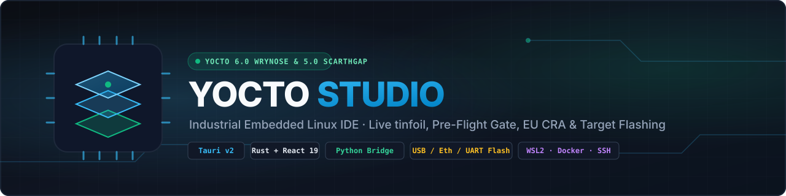
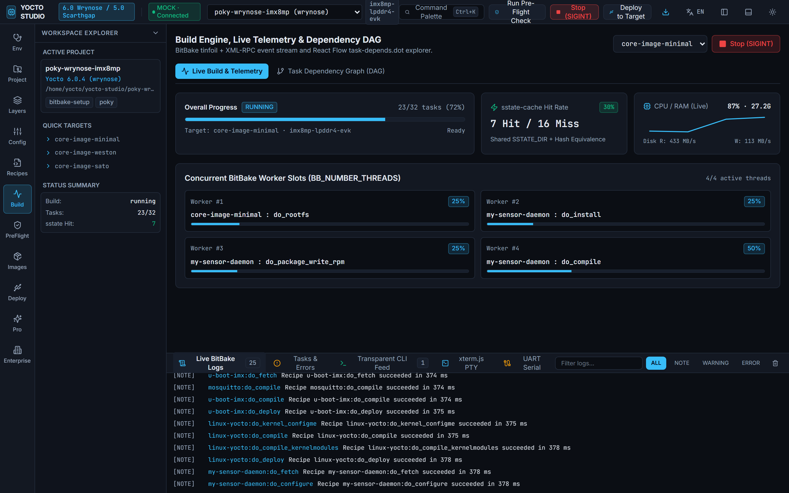
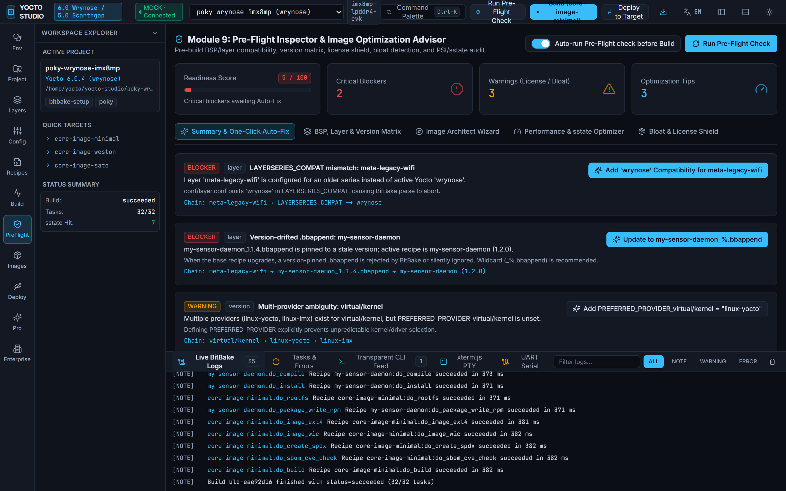
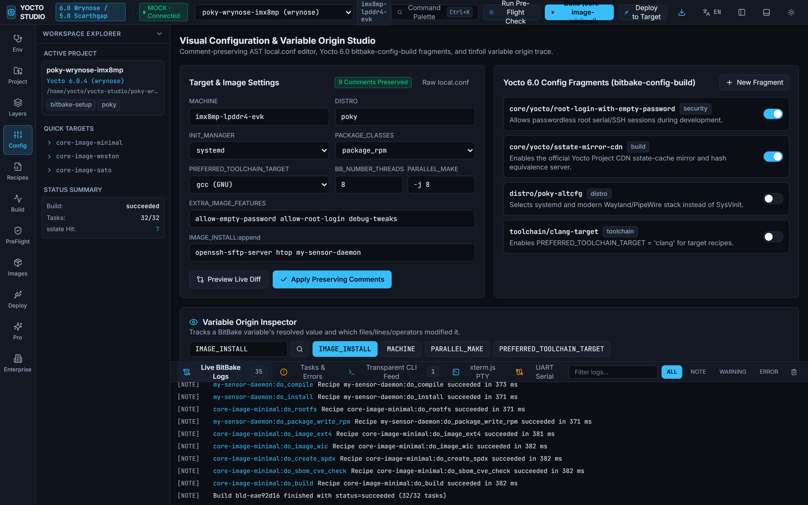
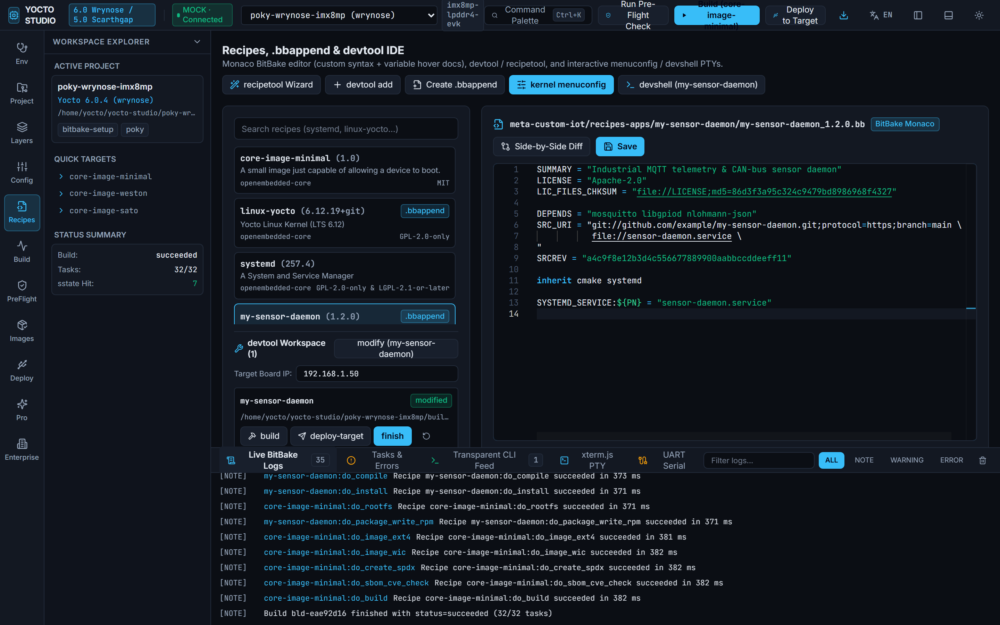
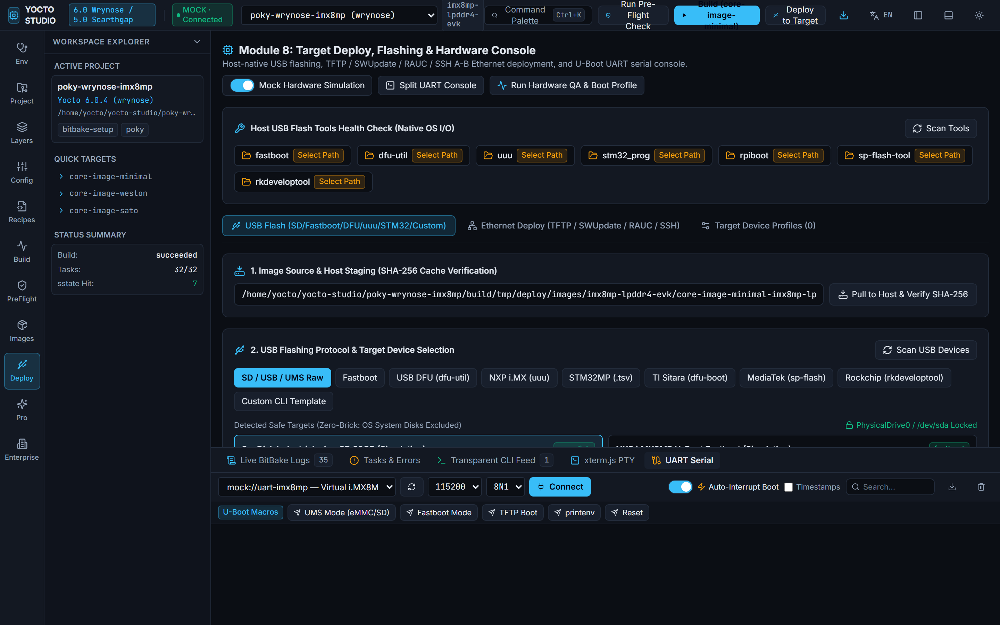
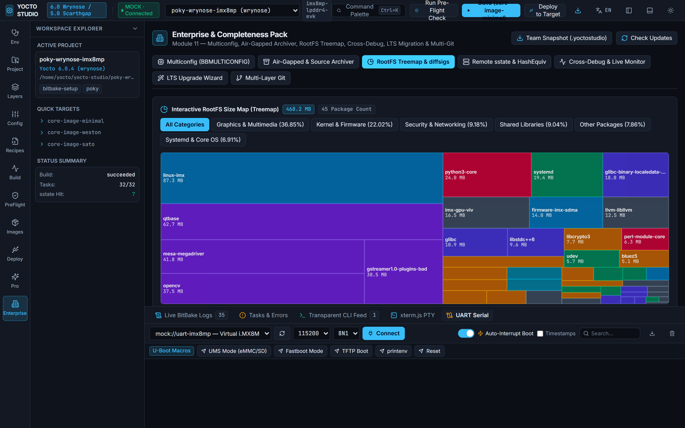
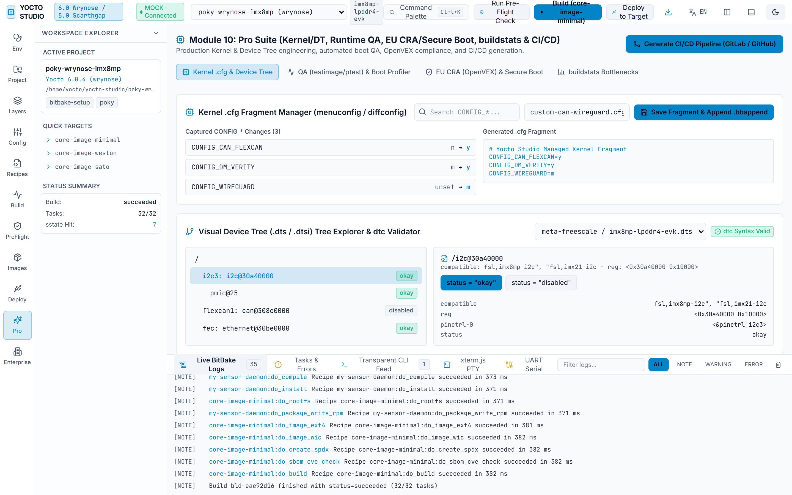
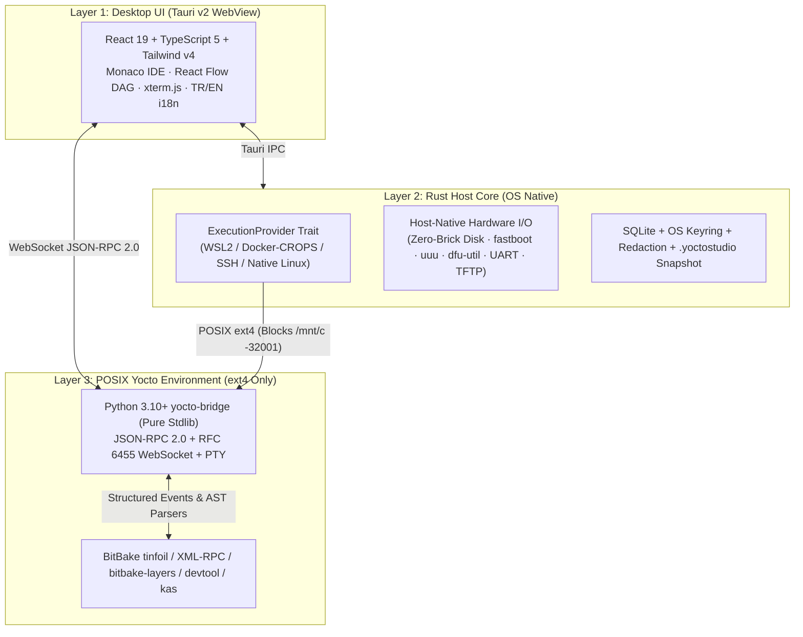
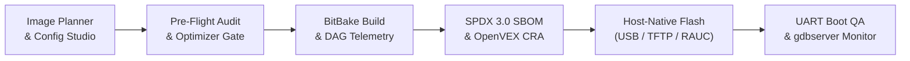

<div align="center">

**English** | [Türkçe](README.tr.md)

<br/>



<br/>

### The Industrial Desktop IDE for Yocto Project 6.0 Wrynose & 5.0 Scarthgap

*Design, audit, build, comply, flash over USB/Ethernet/UART, and cross-debug embedded Linux images — natively on Windows (WSL2/Docker/SSH) and Linux with under 50 MB idle RAM.*

<p>
  
  
  
  <a href="https://github.com/UfkuAcik/Yocto-Project-GUI/actions/workflows/ci.yml">
    
  </a>
  <a href="LICENSE">
    
  </a>
</p>

<p>
  <a href="#why-yocto-studio">Why Yocto Studio?</a> ·
  <a href="#screenshots">Screenshots</a> ·
  <a href="#complete-11-module-feature-matrix">Features</a> ·
  <a href="#system-architecture">Architecture</a> ·
  <a href="#quick-start">Quick Start</a> ·
  <a href="#documentation-map">Docs</a> ·
  <a href="#contributing">Contributing</a>
</p>

</div>

---

## Table of Contents

- [Why Yocto Studio?](#why-yocto-studio)
- [Screenshots](#screenshots)
- [Complete 11-Module Feature Matrix](#complete-11-module-feature-matrix)
- [System Architecture](#system-architecture)
  - [Three-Layer Decoupled Architecture](#three-layer-decoupled-architecture)
  - [End-to-End Embedded Linux Lifecycle](#end-to-end-embedded-linux-lifecycle)
- [Quick Start](#quick-start)
  - [Prerequisites](#prerequisites)
  - [Try Instantly in Mock Mode (30 Seconds)](#try-instantly-in-mock-mode-30-seconds)
  - [Build Installers (Windows & Linux)](#build-installers-windows--linux)
- [Documentation Map](#documentation-map)
- [Roadmap](#roadmap)
- [Contributing](#contributing)
- [License](#license)

---

## Why Yocto Studio?

Traditional Yocto workflows scatter engineers across dozens of CLI terminals, brittle `local.conf` edits, disconnected USB flashing tools, and sluggish browser-only dashboards (`Toaster`). **Yocto Studio** unifies the entire embedded Linux lifecycle into a single native desktop engineering studio without touching BitBake's POSIX guarantees.

| Capability | Classic CLI + Toaster | **Yocto Studio** |
| --- | --- | --- |
| **Desktop Footprint** | Heavy Electron/browser + multiple shells | **Tauri v2 native webview (<50 MB idle RAM)** |
| **Windows 10/11 Ergonomics** | Manual WSL2 setup, accidental slow `/mnt/c` builds | **WSL2 `ext4` guard (`-32001`), `.wslconfig` & `.vhdx` tuner, Docker/CROPS & SSH** |
| **Config Editing** | Regex/sed risks stripping comments | **Lossless comment-preserving AST editor + Variable Origin Trace** |
| **Pre-Build Failure Detection** | Wait hours for `do_compile` / QA errors | **Pre-Flight Inspector & Gate catches layer/license/OOM issues in seconds** |
| **Hardware Flashing** | Requires `usbipd-win` + separate TFTP/Putty/fastboot CLI | **Host-native USB (`fastboot`, `uuu`, `dfu-util`, raw disk Zero-Brick), TFTP/SWUpdate/RAUC & UART macros** |
| **EU CRA & Compliance** | Manual spreadsheet tracking of CVEs & SPDX | **Built-in SPDX 3.0 SBOM, OpenVEX triage, Secure Boot FIT/`dm-verity` wizard** |
| **AI Build Triage** | Copy-pasting sensitive logs manually | **Opt-In local Ollama / BYOK Keyring with automatic secret & IP redaction** |
| **LTS Upgrades & Analysis** | Manual grep across layers | **4.0 → 5.0 → 6.0 Auto-Migrate Diff, 40+ pkg RootFS Treemap & `bitbake-diffsigs`** |

---

## Screenshots

| Live Build Engine & DAG | Pre-Flight Inspector & Advisor |
| :---: | :---: |
|  |  |
| **Config Studio & Variable Trace** | **Monaco BitBake IDE & `devtool`** |
|  |  |
| **Target Deploy (USB/Eth) & UART Console** | **Enterprise RootFS Treemap & `diffsigs`** |
|  |  |

<div align="center">
  
  <br/>
  <sub><b>High-Contrast Crisp Light Theme — Pro Suite (Kernel Fragments, Device Tree, OpenVEX CRA &amp; CI/CD)</b></sub>
</div>

---

## Complete 11-Module Feature Matrix

| Module | Name | Key Capabilities |
| :---: | --- | --- |
| **1–2** | **Environment Doctor & Providers** | Host RAM/Disk/CPU checks, WSL2 `ext4` enforcement (`-32001`), `.wslconfig`, Docker/CROPS, SSH tunnel, Native Linux |
| **3** | **Workspace & Layer Ecosystem** | `bitbake-setup`, `kas` two-way YAML, `oe-init-build-env`, live OE Layer Index search, `meta-*` generator |
| **4** | **Config Studio & Variable Trace** | Lossless comment-preserving `local.conf`/`bblayers.conf` AST editor, config fragments, variable history inspector |
| **5** | **Recipe & `devtool` IDE** | Monaco Editor with BitBake syntax, `recipetool` (CMake/Meson/Autotools/Cargo/Python/Go), `devtool` lifecycle, `xterm.js` PTY |
| **6** | **Live Build Engine & DAG** | BitBake XML-RPC/`tinfoil` task telemetry, 100k+ virtualized log viewer, `task-depends.dot` React Flow explorer |
| **7** | **Artifacts, SBOM, WIC & QEMU** | SPDX 3.0 SBOM & `sbom-cve-check`, `.wks` partition designer, `runqemu` launcher, `buildhistory` diff, SDK/eSDK |
| **8** | **Target Deploy & Hardware Console** | Host-native USB (`raw_disk` Zero-Brick, `fastboot`, `uuu`, `dfu-util`, `STM32_Programmer_CLI`, Custom CLI), TFTP/SWUpdate/RAUC/SSH, UART console |
| **9** | **Pre-Flight Inspector & Image Advisor** | Layer/version/license audit, `sstate`/hashserve probe, PSI/OOM optimizer, guided Image Planner, Build Gate |
| **10** | **Pro Suite** | Kernel `.cfg` & `.dts`/`.dtsi` studio, `testimage`/`ptest` & boot profiler, EU CRA OpenVEX + Secure Boot, Opt-In AI Triage, `buildstats`, CI/CD YAML |
| **11** | **Enterprise & Completeness Pack** | `BBMULTICONFIG`, Air-Gapped mirror & GPL archiver, RootFS Treemap + `oe-pkgdata-util` + `diffsigs`, `gdbserver` + live monitor, LTS Migration, Multi-Git, `.yoctostudio` Snapshot, TR/EN i18n, Auto-Updater |

<details>
<summary><b>Click to expand detailed hardware, security, and enterprise engineering workflows</b></summary>

- **Zero-Brick Host-Native Flashing (Module 8):** Rust automatically stages images, `.bmap`, and `.sha256` checksums from WSL2/Docker/SSH to host cache, blocks OS system drives (`PhysicalDrive0`, `C:\`, Linux `/`), and executes host-native USB/COM I/O without requiring `usbipd-win`.
- **Pre-Flight Gate (Module 9):** Checks `LAYERSERIES_COMPAT`, `LAYERDEPENDS`, orphaned `.bbappend`s, `PREFERRED_PROVIDER` conflicts, and `INCOMPATIBLE_LICENSE` violations before a multi-hour build begins, offering one-click unified-diff fixes.
- **Privacy-First AI & Compliance (Module 10):** Exports SPDX 3.0 + OpenVEX + license CSV bundles for EU CRA readiness; AI triage stays off until opted-in and scrubs secrets/internal IPs before calling local Ollama or BYOK APIs.
- **Zero-Leakage Team Collaboration (Module 11):** Exports `.yoctostudio` (JSON/ZIP) project bundles with SSH private keys, keyring API keys, and URL passwords automatically stripped.

</details>

---

## System Architecture

### Three-Layer Decoupled Architecture



### End-to-End Embedded Linux Lifecycle



---

## Quick Start

### Prerequisites

- **OS:** Windows 10/11 (with WSL2 Ubuntu/Debian on `ext4` or Docker Desktop for live builds) **or** Native Linux (`Ubuntu 22.04/24.04` recommended).
- **Mock Mode / Browser Preview:** Node.js `22+`, pnpm `10+`, Python `3.10+` (`yocto-bridge` uses only Python's standard library at runtime — no `pip install` needed).
- **Native Tauri Desktop Window & Installers:**
  - Rust `1.80+`
  - **Windows:** [Visual Studio Build Tools](https://aka.ms/vs/17/release/vs_BuildTools.exe) (*Desktop development with C++* + Windows SDK) and WebView2 Runtime.
  - **Linux (Ubuntu/Debian):** `sudo apt-get install -y libwebkit2gtk-4.1-dev libappindicator3-dev librsvg2-dev patchelf libudev-dev pkg-config libssl-dev libgtk-3-dev`
- **Windows PowerShell Note:** If PowerShell blocks `pnpm` or `.ps1` scripts (`ExecutionPolicy` / `UnauthorizedAccess`), run `Set-ExecutionPolicy -Scope CurrentUser RemoteSigned` once, or use `pnpm.cmd` / `cmd.exe`.

### Try Instantly in Mock Mode (30 Seconds)

You can evaluate every single module—including live BitBake build streaming, Pre-Flight audits, Kernel/DT studio, Target Deploy UART macros, RootFS 45-package Treemap, and LTS Migration—without an active Linux Yocto checkout:

```bash
git clone https://github.com/UfkuAcik/Yocto-Project-GUI.git
cd Yocto-Project-GUI

# 1. Install JS dependencies and build shared protocol
pnpm install
pnpm --filter @yocto-studio/shared-protocol build

# 2. Launch Browser Preview (starts Mock Python Bridge on :18765 + Vite UI on :1420)
pnpm dev
```

Then open **`http://localhost:1420`** in your browser.
*(Or start them in two separate terminals: `pnpm dev:bridge` in Terminal 1 and `pnpm dev:desktop` in Terminal 2, then open `http://localhost:1420`.)*

- **Native Desktop Window (Tauri v2, requires Rust + C++/WebKitGTK prerequisites):**
  ```bash
  pnpm dev:tauri
  ```
  *(Automatically starts the Mock Python Bridge and opens the native desktop window.)*

- **Optional — Python Bridge Tests & Lint (`pytest` + `ruff`):**
  Not required to run Mock Mode (`yocto-bridge` is pure Python stdlib). Needed only to run `pnpm test:bridge` and `pnpm lint:bridge`:
  - Windows PowerShell:
    ```powershell
    python -m venv packages/yocto-bridge/.venv
    packages\yocto-bridge\.venv\Scripts\python.exe -m pip install pytest pytest-asyncio ruff
    ```
  - Linux / macOS:
    ```bash
    python3 -m venv packages/yocto-bridge/.venv
    packages/yocto-bridge/.venv/bin/python -m pip install pytest pytest-asyncio ruff
    ```

### Build Installers (Windows & Linux)

- **Windows (`.exe` NSIS & `.msi`):**
  ```powershell
  .\scripts\package.ps1
  # Or if PowerShell scripts are restricted:
  powershell -ExecutionPolicy Bypass -File .\scripts\package.ps1
  # Output: apps/desktop/src-tauri/target/release/bundle/
  ```
- **Linux (`.AppImage` & `.deb`):**
  ```bash
  pnpm --filter @yocto-studio/shared-protocol build
  pnpm --filter @yocto-studio/desktop tauri build --bundles appimage deb
  ```

---

## Documentation Map

- [ARCHITECTURE.md](docs/ARCHITECTURE.md) — Monorepo layout, ADR-001..003, JSON-RPC 2.0/WebSocket/PTY contracts, `ExecutionProvider` & `TargetFlasher` traits, sequence diagrams.
- [PROTOCOL.md](docs/PROTOCOL.md) — Complete RPC method & server notification reference across Modules 1–11.
- [WINDOWS_GUIDE.md](docs/WINDOWS_GUIDE.md) — WSL2 `ext4` vs `/mnt/c` NTFS guard, `.wslconfig` sizing, VHDX compaction, Docker/CROPS volumes, and driver-free host USB/COM flashing.
- [MODULES.md](docs/MODULES.md) — Deep-dive engineering user manual for all 11 modules.
- [DEVELOPMENT.md](docs/DEVELOPMENT.md) — Adding custom flasher profiles, Pre-Flight rules, refreshing screenshots, and release signing.
- [CHANGELOG.md](CHANGELOG.md) · [SECURITY.md](SECURITY.md) · [CONTRIBUTING.md](CONTRIBUTING.md)

---

## Roadmap

- [x] Prebuilt signed GitHub Releases (`.msi`, `.exe`, `.AppImage`, `.deb`) with live Tauri v2 auto-updater manifest publishing (`.github/workflows/release.yml` + `latest.json`)
- [x] Remote `sstate-cache` & Hash Equivalence dashboard analytics across CI runners (`enterprise.sstate.getRunnerAnalytics`)
- [x] Additional vendor USB flasher presets (TI `dfu-boot`, MediaTek `sp-flash-tool`, Rockchip `rkdeveloptool`)

---

## Contributing

Contributions are welcome! Please read [CONTRIBUTING.md](CONTRIBUTING.md) and ensure all TypeScript, Rust, and Python checks pass before submitting a Pull Request.

## License

Released under the [MIT License](LICENSE). Copyright © 2026 **UfkuAcik**.
