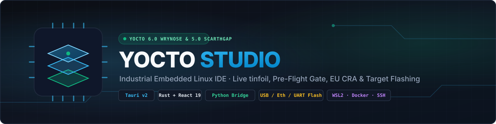
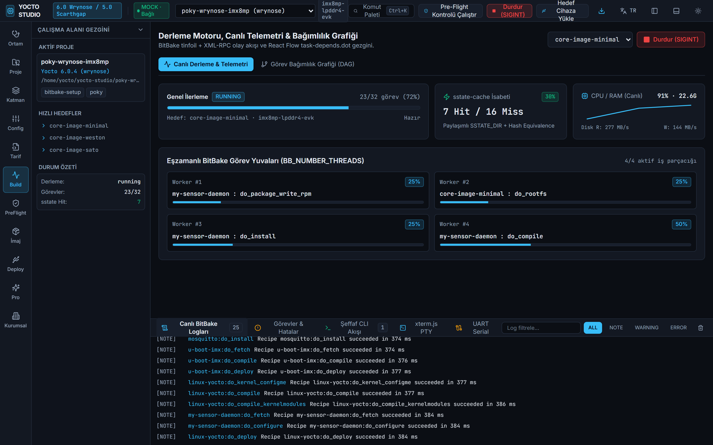
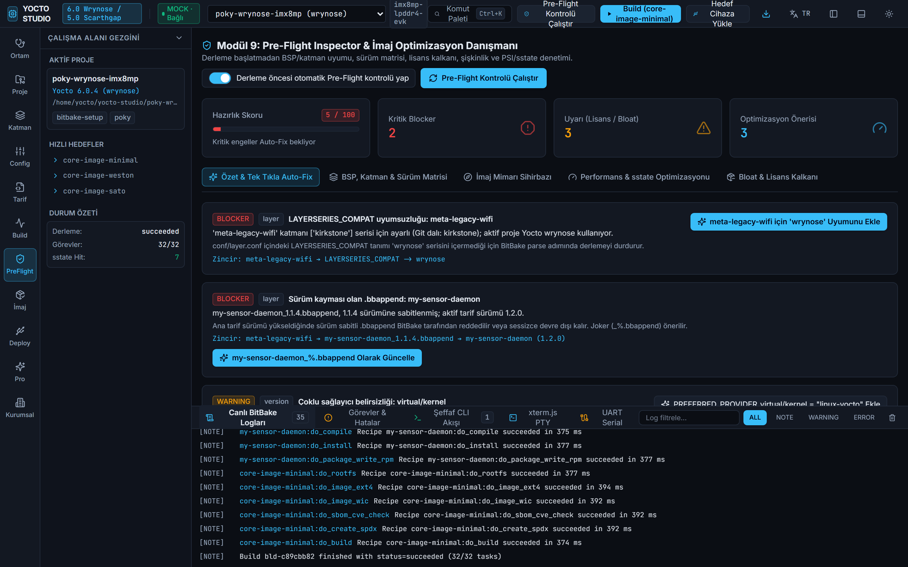
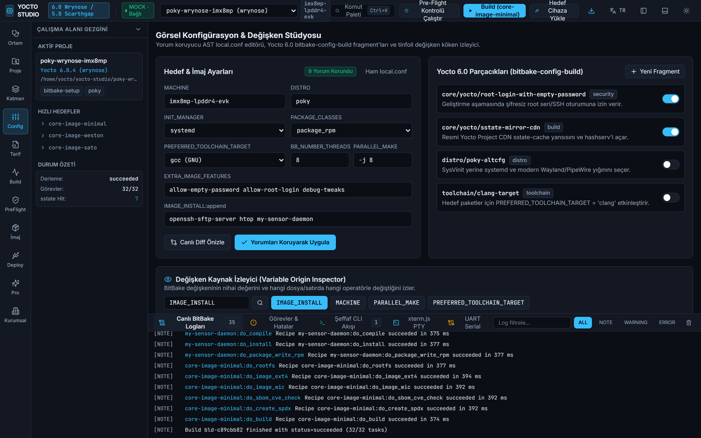
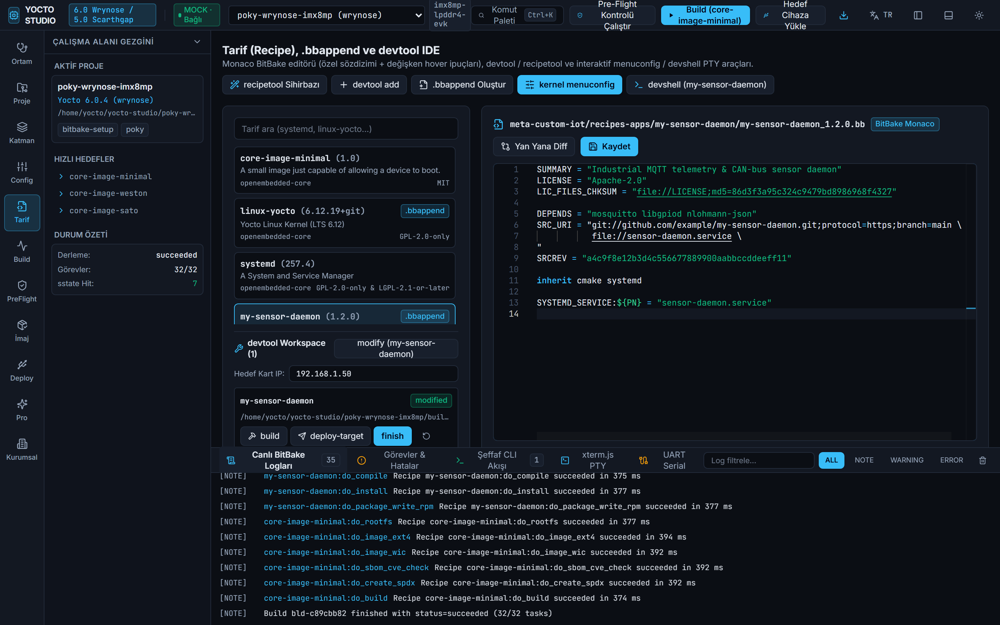
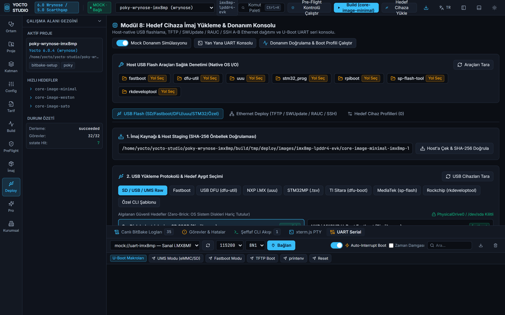
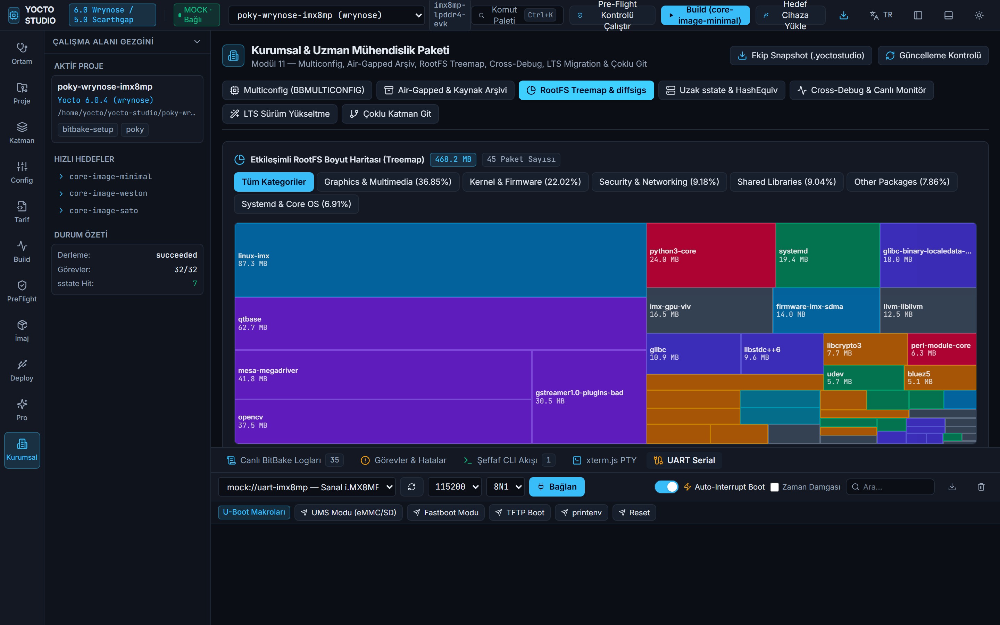
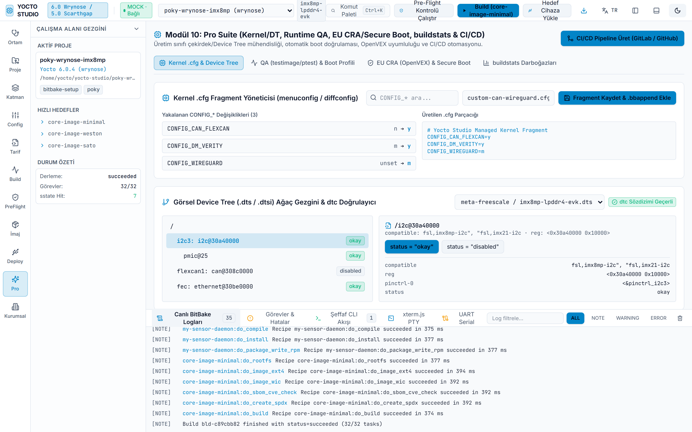
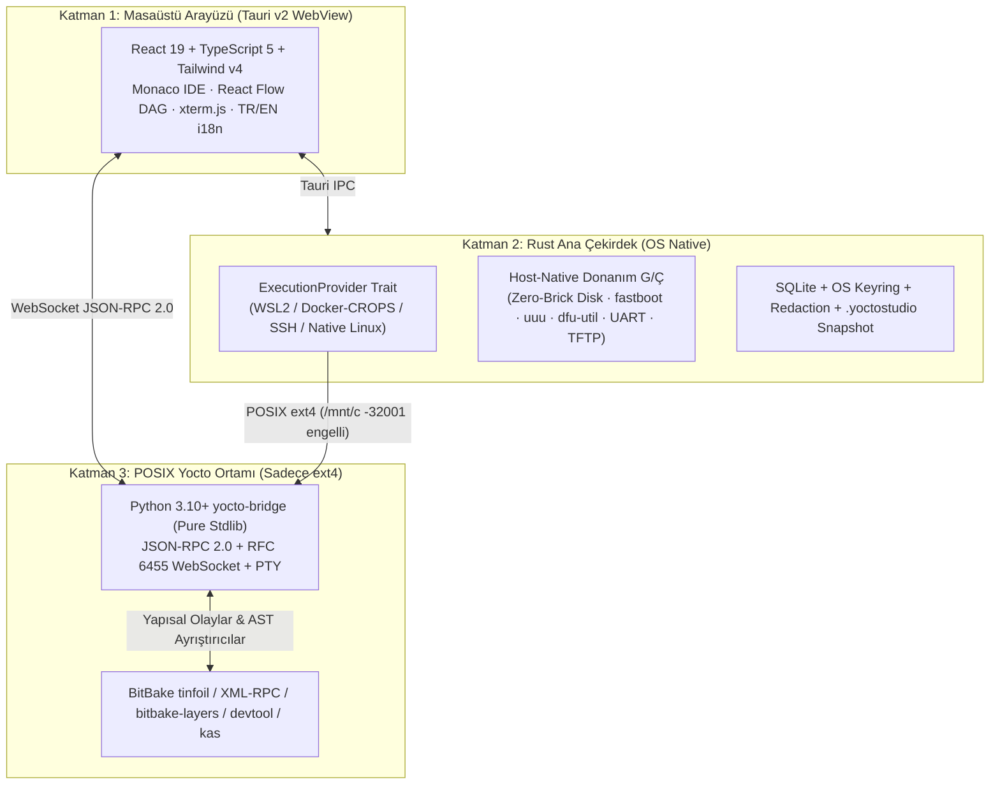
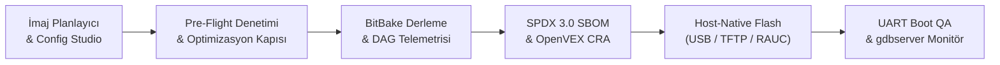

<div align="center">

[English](README.md) | **Türkçe**

<br/>



<br/>

### Yocto Project 6.0 Wrynose ve 5.0 Scarthgap İçin Endüstriyel Masaüstü IDE

*Gömülü Linux imajlarını tasarlayın, derleme öncesi denetleyin, derleyin, EU CRA uyumluluğu üretin, USB/Ethernet/UART ile cihaza yükleyin ve uzaktan hata ayıklayın — Windows (WSL2/Docker/SSH) ve Linux'ta boşta <50 MB RAM tüketimiyle.*

<p>
  
  
  
  <a href="https://github.com/UfkuAcik/Yocto-Project-GUI/actions/workflows/ci.yml">
    
  </a>
  <a href="LICENSE">
    
  </a>
</p>

<p>
  <a href="#neden-yocto-studio">Neden Yocto Studio?</a> ·
  <a href="#ekran-görüntüleri">Ekran Görüntüleri</a> ·
  <a href="#11-modüllü-tam-özellik-matrisi">Özellikler</a> ·
  <a href="#sistem-mimarisi">Mimari</a> ·
  <a href="#hızlı-kurulum">Hızlı Kurulum</a> ·
  <a href="#dokümantasyon-haritası">Dokümanlar</a> ·
  <a href="#katkıda-bulunma">Katkı</a>
</p>

</div>

---

## İçindekiler

- [Neden Yocto Studio?](#neden-yocto-studio)
- [Ekran Görüntüleri](#ekran-görüntüleri)
- [11 Modüllü Tam Özellik Matrisi](#11-modüllü-tam-özellik-matrisi)
- [Sistem Mimarisi](#sistem-mimarisi)
  - [Üç Katmanlı Ayrık Mimari](#üç-katmanlı-ayrık-mimari)
  - [Uçtan Uca Gömülü Linux Yaşam Döngüsü](#uçtan-uca-gömülü-linux-yaşam-döngüsü)
- [Hızlı Kurulum](#hızlı-kurulum)
  - [Ön Koşullar](#ön-koşullar)
  - [Mock Mode ile 30 Saniyede Deneyin](#mock-mode-ile-30-saniyede-deneyin)
  - [Kurulum Paketleri Oluşturma (Windows & Linux)](#kurulum-paketleri-oluşturma-windows--linux)
- [Dokümantasyon Haritası](#dokümantasyon-haritası)
- [Yol Haritası](#yol-haritası)
- [Katkıda Bulunma](#katkıda-bulunma)
- [Lisans](#lisans)

---

## Neden Yocto Studio?

Klasik Yocto iş akışları mühendisleri dağınık CLI terminalleri, riskli `local.conf` düzenlemeleri, kopuk USB flash araçları ve hantal web arayüzleri (`Toaster`) arasında böler. **Yocto Studio**, BitBake'in POSIX garantilerinden ödün vermeden tüm gömülü Linux mühendislik yaşam döngüsünü tek yerel masaüstü uygulamasında birleştirir.

| Özellik | Klasik CLI + Toaster | **Yocto Studio** |
| --- | --- | --- |
| **Masaüstü Bellek Ayak İzi** | Ağır Electron/tarayıcı + çoklu terminal | **Tauri v2 yerel webview (boşta <50 MB RAM)** |
| **Windows 10/11 Deneyimi** | Manuel WSL2 kurulumu, yavaş `/mnt/c` NTFS tuzakları | **WSL2 `ext4` zorunluluğu (`-32001`), `.wslconfig` & `.vhdx` bakımı, Docker/CROPS & SSH** |
| **Konfigürasyon Düzenleme** | Regex/sed yüzünden silinen yorum satırları | **Yorum koruyucu AST düzenleyici + Değişken Köken İzleyici** |
| **Derleme Öncesi Teşhis** | Saatler sonra `do_compile` / QA hatası | **Saniyeler içinde Pre-Flight Denetçisi, Optimizasyon & Derleme Kapısı** |
| **Donanıma İmaj Yükleme** | `usbipd-win` + ayrı TFTP/PuTTY/fastboot CLI | **Ana sistemden yerel USB (`fastboot`, `uuu`, `dfu-util`, Zero-Brick raw disk), TFTP/SWUpdate/RAUC & UART makroları** |
| **EU CRA & Uyumluluk** | Elle CVE ve SPDX tablosu takibi | **Dahili SPDX 3.0 SBOM, OpenVEX triyajı, Secure Boot FIT/`dm-verity` sihirbazı** |
| **AI Hata Teşhisi** | Gizli logları elle kopyala-yapıştır | **Varsayılan kapalı (Opt-In) yerel Ollama / BYOK Keyring + otomatik sır/IP maskeleme** |
| **LTS Yükseltme & Analiz** | Katmanlarda elle arama | **4.0 → 5.0 → 6.0 Auto-Migrate Diff, 45 paketlik RootFS Treemap & `bitbake-diffsigs`** |

---

## Ekran Görüntüleri

| Canlı Derleme Motoru ve DAG | Pre-Flight Denetçisi ve Danışmanı |
| :---: | :---: |
|  |  |
| **Konfigürasyon Stüdyosu ve Köken İzleme** | **Monaco BitBake IDE ve `devtool`** |
|  |  |
| **Hedef Yükleme (USB/Eth) ve UART Konsolu** | **Kurumsal RootFS Treemap ve `diffsigs`** |
|  |  |

<div align="center">
  
  <br/>
  <sub><b>Yüksek Kontrastlı Crisp Light Tema — Pro Suite (Kernel Parçacıkları, Device Tree, OpenVEX CRA ve CI/CD)</b></sub>
</div>

---

## 11 Modüllü Tam Özellik Matrisi

| Modül | Adı | Temel Yetenekler |
| :---: | --- | --- |
| **1–2** | **Ortam Denetçisi & Sağlayıcılar** | RAM/Disk/CPU analizi, WSL2 `ext4` koruması (`-32001`), `.wslconfig`, Docker/CROPS, SSH tüneli, Native Linux |
| **3** | **Çalışma Alanı & Katman Ekosistemi** | `bitbake-setup`, `kas` çift yönlü YAML, `oe-init-build-env`, canlı OE Layer Index arama, `meta-*` iskelet üretici |
| **4** | **Konfigürasyon Stüdyosu** | Yorum koruyucu `local.conf`/`bblayers.conf` AST düzenleyici, fragment yönetimi, değişken tarihçesi izleyici |
| **5** | **Tarif & `devtool` IDE** | BitBake renklendirmeli Monaco Editor, `recipetool` (CMake/Meson/Autotools/Cargo/Python/Go), `devtool` yaşam döngüsü, `xterm.js` PTY |
| **6** | **Canlı Derleme Motoru & DAG** | BitBake XML-RPC/`tinfoil` görev telemetrisi, 100k+ sanallaştırılmış log akışı, `task-depends.dot` React Flow grafiği |
| **7** | **İmaj, SBOM, WIC & QEMU** | SPDX 3.0 SBOM & `sbom-cve-check`, `.wks` bölüm düzenleyici, `runqemu`, `buildhistory` farkı, SDK/eSDK |
| **8** | **Hedef Yükleme & Donanım Konsolu** | Host-native USB (`raw_disk` Zero-Brick, `fastboot`, `uuu`, `dfu-util`, `STM32_Programmer_CLI`, Özel CLI), TFTP/SWUpdate/RAUC/SSH, UART |
| **9** | **Pre-Flight Denetçisi & İmaj Danışmanı** | Katman/sürüm/lisans uyumluluk matrisi, `sstate`/hashserve yoklaması, PSI/OOM optimize edici, İmaj Planlayıcı, Derleme Kapısı |
| **10** | **Pro Suite** | Kernel `.cfg` & `.dts`/`.dtsi` stüdyosu, `testimage`/`ptest` & boot profilcisi, EU CRA OpenVEX + Secure Boot, Opt-In AI, `buildstats`, CI/CD |
| **11** | **Kurumsal & Uzman Paketi** | `BBMULTICONFIG`, Air-Gapped mirror & GPL arşivleyici, RootFS Treemap + `oe-pkgdata-util` + `diffsigs`, `gdbserver` + canlı monitör, LTS Migration, Çoklu Git, `.yoctostudio` Snapshot, TR/EN i18n, Auto-Updater |

<details>
<summary><b>Donanım güvenliği, uyumluluk ve kurumsal iş akışı detayları için tıklayın</b></summary>

- **Zero-Brick Host-Native Flashlama (Modül 8):** Rust katmanı imaj, `.bmap` ve `.sha256` dosyalarını WSL2/Docker/SSH'tan otomatik yerel önbelleğe çeker, işletim sistemi disklerini (`PhysicalDrive0`, `C:\`, Linux `/`) kesin olarak dışlar ve `usbipd-win` gerektirmeden doğrudan ana işletim sistemi sürücüleriyle çalışır.
- **Derleme Öncesi Pre-Flight Kapısı (Modül 9):** Saatler süren derleme başlamadan `LAYERSERIES_COMPAT`, `LAYERDEPENDS`, yetim `.bbappend` dosyaları, `PREFERRED_PROVIDER` çakışmaları ve `INCOMPATIBLE_LICENSE` ihlallerini yakalayıp tek tıkla önizlemeli diff uygular.
- **Gizlilik Öncelikli AI & EU CRA (Modül 10):** EU CRA uyumluluğu için SPDX 3.0 + OpenVEX + lisans paketi üretir; AI hata teşhisi varsayılan olarak kapalıdır ve logdaki anahtar/token/özel IP desenlerini maskeler.
- **Sıfır Sızıntılı Ekip Snapshot Paketi (Modül 11):** `.yoctostudio` (JSON/ZIP) dışa aktarımında SSH özel anahtarlarını, OS Keyring API anahtarlarını ve URL parolalarını otomatik temizler.

</details>

---

## Sistem Mimarisi

### Üç Katmanlı Ayrık Mimari



### Uçtan Uca Gömülü Linux Yaşam Döngüsü



---

## Hızlı Kurulum

### Ön Koşullar

- **İşletim Sistemi:** Windows 10/11 (gerçek derlemeler için `ext4` üzerinde WSL2 Ubuntu/Debian veya Docker Desktop) **veya** Native Linux (`Ubuntu 22.04/24.04` önerilir).
- **Mock Mode / Tarayıcı Önizlemesi:** Node.js `22+`, pnpm `10+`, Python `3.10+` (`yocto-bridge` çalışma zamanında yalnızca Python standart kütüphanesini kullanır — `pip install` gerekmez).
- **Yerel Tauri Masaüstü Penceresi ve Kurulum Paketleri:**
  - Rust `1.80+`
  - **Windows:** [Visual Studio Build Tools](https://aka.ms/vs/17/release/vs_BuildTools.exe) (*C++ ile masaüstü geliştirme* + Windows SDK) ve WebView2 Runtime.
  - **Linux (Ubuntu/Debian):** `sudo apt-get install -y libwebkit2gtk-4.1-dev libappindicator3-dev librsvg2-dev patchelf libudev-dev pkg-config libssl-dev libgtk-3-dev`
- **Windows PowerShell Notu:** PowerShell `pnpm` veya `.ps1` betiklerini `ExecutionPolicy` (`UnauthorizedAccess`) nedeniyle engellerse bir kez `Set-ExecutionPolicy -Scope CurrentUser RemoteSigned` çalıştırın veya `pnpm.cmd` / `cmd.exe` kullanın.

### Mock Mode ile 30 Saniyede Deneyin

Aktif bir Linux Yocto kurulumuna ihtiyaç duymadan canlı derleme akışı, Pre-Flight puanlaması, Kernel/Device Tree editörü, UART konsolu, 45 paketlik RootFS Treemap ve LTS Migration dahil tüm özellikleri hemen deneyebilirsiniz:

```bash
git clone https://github.com/UfkuAcik/Yocto-Project-GUI.git
cd Yocto-Project-GUI

# 1. JS bağımlılıklarını kurun ve ortak protokolü derleyin
pnpm install
pnpm --filter @yocto-studio/shared-protocol build

# 2. Tarayıcı Önizlemesini başlatın (Mock Python Bridge :18765 + Vite UI :1420)
pnpm dev
```

Ardından tarayıcınızda **`http://localhost:1420`** adresini açın.
*(Veya iki ayrı terminalde çalıştırın: Terminal 1'de `pnpm dev:bridge`, Terminal 2'de `pnpm dev:desktop`, sonra tarayıcıda `http://localhost:1420` adresini açın.)*

- **Yerel Masaüstü Penceresi (Tauri v2; Rust + C++/WebKitGTK gerektirir):**
  ```bash
  pnpm dev:tauri
  ```
  *(Mock Python Bridge'i otomatik başlatıp yerel masaüstü penceresini açar.)*

- **İsteğe Bağlı — Python Bridge Testleri ve Lint (`pytest` + `ruff`):**
  Mock Mode'u çalıştırmak için gerekli değildir (`yocto-bridge` saf Python stdlib kullanır). Yalnızca `pnpm test:bridge` ve `pnpm lint:bridge` için gerekir:
  - Windows PowerShell:
    ```powershell
    python -m venv packages/yocto-bridge/.venv
    packages\yocto-bridge\.venv\Scripts\python.exe -m pip install pytest pytest-asyncio ruff
    ```
  - Linux / macOS:
    ```bash
    python3 -m venv packages/yocto-bridge/.venv
    packages/yocto-bridge/.venv/bin/python -m pip install pytest pytest-asyncio ruff
    ```

### Kurulum Paketleri Oluşturma (Windows & Linux)

- **Windows (`.exe` NSIS ve `.msi`):**
  ```powershell
  .\scripts\package.ps1
  # PowerShell betikleri kısıtlıysa:
  powershell -ExecutionPolicy Bypass -File .\scripts\package.ps1
  # Çıktı: apps/desktop/src-tauri/target/release/bundle/
  ```
- **Linux (`.AppImage` ve `.deb`):**
  ```bash
  pnpm --filter @yocto-studio/shared-protocol build
  pnpm --filter @yocto-studio/desktop tauri build --bundles appimage deb
  ```

---

## Dokümantasyon Haritası

- [ARCHITECTURE.md](docs/ARCHITECTURE.md) — Monorepo yapısı, ADR-001..003, JSON-RPC 2.0/WebSocket/PTY sözleşmeleri, `ExecutionProvider` & `TargetFlasher` trait tasarımları ve sekans diyagramı.
- [PROTOCOL.md](docs/PROTOCOL.md) — Modül 1–11 JSON-RPC 2.0 metot ve sunucu bildirim listesi.
- [WINDOWS_GUIDE.md](docs/WINDOWS_GUIDE.md) — WSL2 `ext4` zorunluluğu, `/mnt/c` NTFS `-32001` engeli, `.wslconfig` bellek/CPU ayarı, `.vhdx` bakımı, Docker/CROPS volume yapısı ve `usbipd-win`'siz USB/COM flashlama.
- [MODULES.md](docs/MODULES.md) — Modül 1'den Modül 11'e ayrıntılı mühendislik kullanım kılavuzu.
- [DEVELOPMENT.md](docs/DEVELOPMENT.md) — Geliştirici kurulumu, özel flasher profili / Pre-Flight kuralı ekleme, ekran görüntüsü yenileme ve sürüm imzalama.
- [CHANGELOG.md](CHANGELOG.md) · [SECURITY.md](SECURITY.md) · [CONTRIBUTING.md](CONTRIBUTING.md)

---

## Yol Haritası

- [x] Tauri v2 imzalı otomatik güncelleme manifesti (`latest.json`) ile hazır GitHub Releases (`.msi`, `.exe`, `.AppImage`, `.deb`) dağıtımları (`.github/workflows/release.yml`)
- [x] CI çalıştırıcıları arasında paylaşımlı uzak `sstate-cache` ve Hash Equivalence analitiği (`enterprise.sstate.getRunnerAnalytics`)
- [x] Ek kart üreticisi USB flasher profilleri (TI `dfu-boot`, MediaTek `sp-flash-tool`, Rockchip `rkdeveloptool`)

---

## Katkıda Bulunma

Katkılarınız değerlidir! Lütfen [CONTRIBUTING.md](CONTRIBUTING.md) dosyasını okuyun ve PR açmadan önce TypeScript, Rust ve Python kontrollerinin tamamını çalıştırın.

## Lisans

[MIT Lisansı](LICENSE) altında yayınlanmıştır. Telif Hakkı © 2026 **UfkuAcik**.
