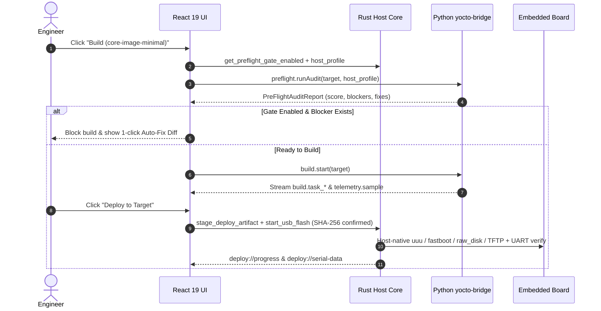

# Yocto Studio — Architecture & Design Records

## 1. Monorepo Layout

```text
yocto-studio/
├── apps/
│   └── desktop/
│       ├── src/                    # React 19 + TypeScript 5 + Tailwind v4 UI
│       │   ├── app/                # LayoutShell, CommandPalette
│       │   ├── features/           # 11 modular domain views (Modules 1–11)
│       │   ├── i18n/               # react-i18next TR/EN locale bundles
│       │   ├── lib/                # rpcClient, tauriApi, deployApi, preflightApi, proSuiteApi, enterpriseApi
│       │   └── stores/             # Zustand state stores
│       └── src-tauri/              # Rust Tauri v2 Host Core
│           ├── src/
│           │   ├── ai_triage/      # Opt-in AI triage + secret/IP redaction + OS keyring
│           │   ├── bridge/         # Bridge process lifecycle & WS supervision
│           │   ├── commands/       # Tauri IPC handlers (core, deploy, preflight, pro, enterprise)
│           │   ├── db/             # SQLite persistence (projects, profiles, settings, qa_runs)
│           │   ├── deploy/         # TargetFlasher trait, staging, USB/Ethernet flashers, TFTP, UART
│           │   ├── flash/          # Zero-Brick removable drive detection & OS disk exclusion
│           │   ├── providers/      # ExecutionProvider trait (WSL2, Docker, SSH, Local, Mock)
│           │   └── pty/            # Host-native PTY session manager
│           └── capabilities/
├── packages/
│   ├── shared-protocol/            # TypeScript + Zod JSON-RPC 2.0 schema & method contracts
│   └── yocto-bridge/               # Pure-stdlib Python 3.10+ daemon & parsers (Modules 1–11)
└── docs/                           # Architecture, Protocol, Windows Guide, Modules & Assets
```

## 2. Architecture Decision Records (ADR)

### ADR-001: Three-Layer Decoupled Architecture (UI / Rust Host Core / Python `yocto-bridge`)
- **Decision:** Desktop UI (Tauri v2 + React 19 + TypeScript) is strictly separated from the Yocto/BitBake engine (`packages/yocto-bridge`), mediated by Rust's host core.
- **Rationale:** BitBake requires `pseudo` (fakeroot), POSIX permissions, symlinks, and a case-sensitive `ext4` filesystem; it cannot run natively on the Windows kernel. Tauri v2's native webview consumes `<50 MB` idle RAM, leaving maximum host memory for 32+ GiB Yocto 6.0 Wrynose builds.
- **Transport:** `ExecutionProvider` in `apps/desktop/src-tauri/src/providers/` abstracts WSL2, Docker/CROPS/`kas`, Remote SSH, and Native Linux backends behind a uniform interface.

### ADR-002: Structured JSON-RPC 2.0 + WebSocket + PTY Protocol
- **Decision:** All queries, mutations, and telemetry events flow over typed JSON-RPC 2.0 + RFC 6455 WebSocket streams defined in [packages/shared-protocol/src/methods.ts](../packages/shared-protocol/src/methods.ts). Interactive terminal sessions (`menuconfig`, `devshell`, `runqemu`) travel over dedicated PTY streams.
- **Rationale:** Regex scraping `knotty` terminal output is brittle. `yocto-bridge` wraps BitBake's `tinfoil` API, XML-RPC events, `bitbake-layers`, `devtool`, `recipetool`, `oe-pkgdata-util`, `bitbake-diffsigs`, and `kas` directly.
- **Zero Runtime Dependencies:** `yocto-bridge` runs strictly on Python 3.10+ standard library (including its async HTTP/WebSocket/JSON-RPC server), enabling zero-pip injection into any WSL2 distro, container, or remote SSH server.

### ADR-003: WSL2 `ext4` Enforcement & `/mnt/c` NTFS Protection
- **Decision:** Opening or creating workspaces under `/mnt/c` (or any `/mnt/<drive>`, Windows `C:\...`, or UNC `\\...` path) on WSL2 or Linux is rejected in both Rust (`providers::wsl2`) and Python (`bridge.protocol.validate_linux_workspace_path`) with error `-32001` (`NTFS_PATH_FORBIDDEN`).
- **Rationale:** DrvFs/9p NTFS mounts introduce extreme I/O degradation, broken hard/symbolic links, and case-insensitivity build corruption.

### ADR-004: Host-Native Hardware I/O & Zero-Brick Guardrails (`TargetFlasher`)
- **Decision:** USB flashers (`raw_disk`, `fastboot`, `dfu-util`, NXP `uuu`, `STM32_Programmer_CLI`, validated Custom CLI), TFTP server, and UART serial ports (`COM*` / `/dev/ttyUSB*`) execute directly on the host OS inside Rust—never inside WSL2 or Docker (`usbipd-win` is unnecessary).
- **Guardrails:** OS system disks (`PhysicalDrive0`, `C:\`, `/`) are filtered out before listing or writing. Remote/WSL2 artifacts are staged to `<app_data>/staging/<project>/<machine>/` and verified via SHA-256 before flashing.

## 3. Sequence Diagram: Pre-Flight Gate, Build & Target Deploy


